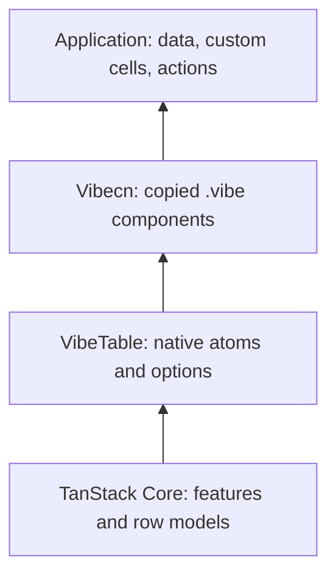

# Native TanStack Table v9 adapter

Status: Accepted · Verified: 2026-10-26

## Compatibility decision

Pin `@tanstack/table-core` **9.3.1** and `@tanstack/store` **0.11.2**. npm's stable `latest` tag resolves to Table 9.3.1. The installed declarations expose the feature-based API, `constructTable`, `TableReactivityBindings`, separate state atoms, and `coreReactivityFeature`. There is no compatibility blocker requiring v8. V8 names such as `getCoreRowModel`, `getSortedRowModel`, and `useReactTable` are not adapter APIs. V9 factories use `createSortedRowModel()` and live in `features.sortedRowModel`.

Sources: [Table v9 reactivity](https://tanstack.com/blog/tanstack-table-v9-reactivity), [Table state](https://tanstack.com/table/latest/docs/framework/vue/guide/table-state), [Core package](https://www.npmjs.com/package/@tanstack/table-core/v/9.3.1). The installed package types and code were checked alongside the official documentation; runtime behavior is tested against exactly these versions.

## Repository investigation

Vibe.js's AGENTS.md, CONTRACTS.md (C1–C6, C8), decisions 0001, 0004–0006 and 0008 establish ESM packages, a client-only fine-grained runtime, compiler-owned DOM instructions and a matching compiler/runtime version. `packages/ui/src/index.ts` exports the needed public refs, computed values, scopes and synchronous watchers. Reactivity sources confirm shallow refs preserve TanStack instance identity; computed values are lazy and release dependencies when unobserved. `effectScope.ts` and `runtime/watch.ts` confirm child-scope ownership, synchronous flush and disposal of queued work. The component/runtime, slots, compiler codegen, tooling type contracts, `.vibe` behavior tests and HMR tests establish declarative dynamic components, getter props, typed slots and keyed lists. Generic SFCs, JSX and public imperative component renderers are unavailable. Dynamic-component props are deliberately loose in `tooling.ts`.

Vibecn's contracts and decisions establish an offline bundled registry and copy-and-own `.vibe` source distribution. `src/registry.ts` records dependency graphs; `src/install.ts` validates destinations and copies source without editing manifests. Table primitives already implement semantic table elements and token-based classes. Checkbox owns native indeterminate behavior; DropdownMenu owns keyboard/focus behavior. The previous Data Table example reimplemented sorting/filtering/pagination locally. The new registry pattern replaces that example logic with VibeTable while preserving the primitives and installer.

VibeQuery's public `useQuery` accepts reactive options, returns a stable reactive result, and provides Query Core cancellation through query function context. QueryClient is installed with `createVibeQueryPlugin`. It remains an optional application integration; VibeTable has no query dependency.

## Three layers

## Native state graph

Supply Vibe-native `createWritableAtom` and `createReadonlyAtom` implementations through `features.coreReactivityFeature`. Writable atoms use `shallowRef`; readonly atoms use `computed`, including Core's optional equality comparator. Subscriptions use synchronous public `watch`. Core owns slice precedence and updater semantics. Its external atom wrapping is enabled, and the input atom map is copied before construction so Core cannot mutate user configuration. Features, atom maps and initial state are static by Core's own `setOptions` contract.

Do not proxy the table, rows or cells. Reads track the underlying refs. Changes to selection invalidate selection reads without invalidating cached row models. Option-source watching and its untracked callback keep external option writes separate from Core's state reads. Data/column replacement follows Core memoization; deep in-place mutation is outside that contract.

Vibe exposes neither public synchronous batching nor an untracking primitive. DOM work is already queued and deduplicated by its scheduler. The binding's batch callback executes immediately, matching the official Vue adapter's strategy. Synchronous subscribers can observe intermediate slices in a multi-slice reset; there is no atomic multi-slice transaction promise. A short-lived public `watchEffect` isolates Core's untracked reads, is stopped immediately and rethrows captured exceptions. No internal module is accessed.

The adapter requires an active owner. A child effect scope owns subscription watchers, and the parent owns option synchronization. Core-owned external subscriptions are unsubscribed on disposal. Scheduled microtasks check the child scope's active status. Failed construction also disposes the bridge.

## Rendering

`componentRenderer` infers the context from a compiled component's public signature, rejects extra required props and checks assignment to a column's cell/header context. Its output is a descriptor. Consumer `.vibe` source evaluates `renderContent` in a computed value and renders the descriptor with `<component :is="..." :context="..." />`. Text uses normal interpolation. It is never HTML.

Generic SFCs are unsupported, so Vibecn's reusable table components use covariant structural views of the methods they read. Their slot row originals are `unknown`. Typed application cells retain the exact row, feature and value types through `componentRenderer`. Compiled cells remain application source; the headless npm package ships no compiler-generated ABI calls. Vibecn passes a scoped document through Core's supported resize-handler context: removing the component invokes the registered terminal handler, which releases mouse/touch listeners and cancels Core's pending animation frame. Custom gesture renderers own the corresponding document-handler lifecycle.

## Virtualization

The example uses optional `@tanstack/virtual-core` 3.19.7. The class's exported `_didMount`/`_willUpdate` adapter lifecycle hooks are called from public Vibe lifecycle hooks; its built-in observers and scroll implementation perform measurement and scrolling. Vibe renders a semantic table with spacer rows and absolute row indices. The view fixes row height at 40px and bounds overscan. Chromium tests exercise 1,000, 10,000 and 50,000 records; the default view shows 10,000. No custom virtual scrolling engine is implemented. Full grid keyboard navigation and dynamic-height virtualization are not promised. A paginated alternative is available.
